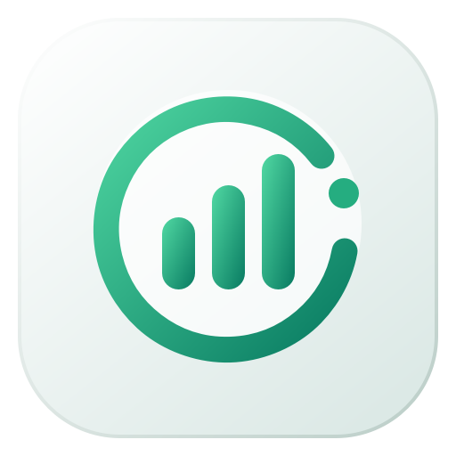
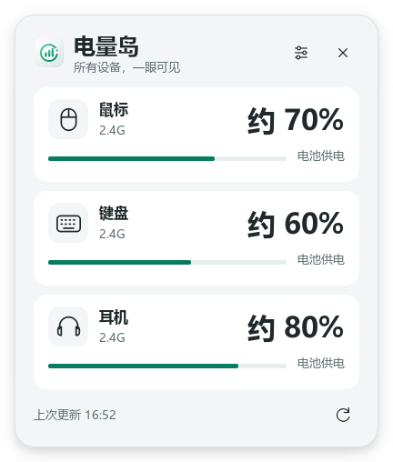

<p align="center"></p>

# 电量岛 · ChargeDock

Windows 托盘外设电量工具，按鼠标、键盘、耳机三个类别显示状态并设置低电量提醒。

**[下载最新版](https://github.com/Greg-Street/ChargeDock/releases/latest) · [使用与适配](docs/GUIDE.md) · [问题反馈](https://github.com/Greg-Street/ChargeDock/issues)**

## 界面预览

<p align="center"></p>

配图使用虚构演示数据。公开界面显示设备类别，不展示使用者的具体型号、设备编号或实测记录。

## 功能

- 原生系统托盘驻留，点击时才打开界面。
- 鼠标、键盘和耳机分别设置低电量提醒与阈值。
- 区分电池供电、接外部电源、等待回复和接收器未连接。
- 接电或读数大幅波动时先标记状态，再确认估计百分比。
- 支持浅色 / 深色和四种界面语言，可选开机启动。
- 使用本地 HID 通信，无联网、账号或遥测功能。

## 下载与使用

1. 从 [Releases](https://github.com/Greg-Street/ChargeDock/releases/latest) 下载 Windows x64 运行包并完整解压。
2. 运行 `ChargeDock.exe`，保留旁边的 `_internal` 文件夹，无需安装 Python。
3. 单击托盘图标查看面板，右键打开设置、刷新、暂停提醒或退出。

本程序只读取代码中已经适配的接收器协议，不是任意外设或蓝牙设备的通用电量工具。不同接收器与固件仍需分别验证。

## 构建

需要 Windows x64、Python 3.11：

```powershell
python -m venv .venv
.\.venv\Scripts\python.exe -m pip install -r requirements-build.txt
.\.venv\Scripts\python.exe -m unittest discover -p "test_*.py" -v
.\.venv\Scripts\python.exe -m PyInstaller --noconfirm ChargeDock.spec
```

产物位于 `dist/ChargeDock/`。配置和诊断数据仅在运行者本机保存，不应加入公开仓库。技术适配信息见 [指南](docs/GUIDE.md)，测试范围见 [验证说明](docs/VALIDATION.md)。

## 边界、来源与许可

百分比来自设备固件，是估计值。供电状态与充电状态不能总是互相推导，项目不承诺改善续航。公开截图不代表任何使用者的真实设备状态。

本工程基于 [SgZincanya/ChargeDock](https://github.com/SgZincanya/ChargeDock) 及相关 HID 与协议参考整理。具体来源见 [ATTRIBUTION.md](ATTRIBUTION.md)，第三方依赖见 [THIRD_PARTY_NOTICES.txt](THIRD_PARTY_NOTICES.txt)。

工程尚未统一声明开源许可证；部分上游未附 LICENSE，使用与再分发前请阅读 [LICENSING.md](LICENSING.md)。参与方式见 [CONTRIBUTING.md](CONTRIBUTING.md)。
